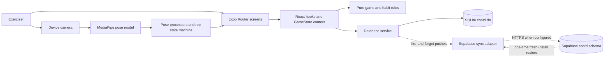

# contrl

> your body is your controller

`contrl` is a local-first mobile workout progression app. It guides one user through push, pull, and squat exercise levels, records workouts and daily habits on the device, can count selected exercises with the camera, and can optionally mirror core workout data to Supabase.

This README is a complete, three-stage onboarding guide: it maps the repository, traces its execution and data behavior, and shows how to investigate failures and design trade-offs.

## Table of contents

- [Evidence and scope](#evidence-and-scope)
- **Stage 1 — Build the repo map**
  - [1. Purpose and boundaries](#1-purpose-and-boundaries)
  - [2. Repository and architecture map](#2-repository-and-architecture-map)
  - [3. Local development and first reading path](#3-local-development-and-first-reading-path)
- **Stage 2 — Connect execution, data, and algorithms**
  - [4. Representative existing flows](#4-representative-existing-flows)
  - [5. Data lifecycle — FODE](#5-data-lifecycle--fode)
  - [6. Data behavior and guarantees — DDIA](#6-data-behavior-and-guarantees--ddia)
  - [7. Computational reasoning — Algorithmic Thinking](#7-computational-reasoning--algorithmic-thinking)
- **Stage 3 — Learn to investigate and explain the repo**
  - [8. Failure, security, and performance](#8-failure-security-and-performance)
  - [9. Design trade-offs and learning summary](#9-design-trade-offs-and-learning-summary)
  - [10. Practical onboarding path](#10-practical-onboarding-path)

## Evidence and scope

This guide was checked against branch `main` at commit `e12ec66` (`ui: make steps goal field tappable`) on 2026-10-18.

Evidence labels used below:

- **Verified** — observed directly in current source, configuration, or a command run in this workspace.
- **Inferred** — a likely implication of the code, not proof of deployed behavior or production load.
- **Unknown** — not established by repository evidence or by a local runtime check.

Inspected areas include the root manifests and configuration; all route entry points; domain types; representative UI, state, game, pose, database, and sync modules; the exercise seed; Supabase migration; Android build configuration; design/spec documents; and the available scripts. The review did not inspect every style declaration, generated Android file, implementation-plan paragraph, dependency source file, binary model byte, or asset pixel. It did not connect to Supabase, launch a simulator/device, run a native build, or inspect a production deployment.

## 1. Purpose and boundaries

### What kind of repository is this?

**Verified:** this is primarily a React Native/Expo application repository, with two supporting roles:

- a generated native Android project for local device builds;
- database infrastructure in the form of a Supabase schema migration.

It is not a monorepo and it does not contain independently deployed backend services. The folders under `src/` are modules in one mobile runtime, not separate services.

### What problem does it solve?

The app turns bodyweight training into a five-level progression for three categories. A user can:

- see current levels and weekly activity on Home;
- log reps or timed holds, manually or with camera assistance;
- resume a partially completed workout from a local draft;
- review workout and habit history;
- record a daily step goal and a fixed four-by-sixty-second plank habit;
- advance a category after repeated clean sessions;
- optionally push workout state to a Supabase mirror and restore it on a fresh install.

The main user-facing outputs are the Home and History tabs, the workout logging flow, Settings, camera overlays, and result summaries. Expo/EAS can produce Android development or preview APKs and a production Android App Bundle; iOS and web scripts also exist, but their current behavior was not verified.

### Actors and external systems

| Actor or system | Responsibility | Boundary evidence |
|---|---|---|
| Exerciser | Logs workouts and habits; grants camera permission; chooses whether to configure sync. | Routes in [`app/`](app/) |
| Mobile app | Owns navigation, state orchestration, progression rules, UI, and offline behavior. | [`app/_layout.tsx#L20-L74`](app/_layout.tsx#L20-L74) |
| SQLite on the device | Runtime persistence and the data source used by screens and hooks. | [`src/services/database.ts#L25-L30`](src/services/database.ts#L25-L30) |
| Camera + MediaPipe model | Produces pose landmarks used by local rep/hold processors. | [`src/components/camera/PoseCamera.tsx#L19-L76`](src/components/camera/PoseCamera.tsx#L19-L76), [`models/pose_landmarker_lite.task`](models/pose_landmarker_lite.task) |
| Supabase | Optional remote mirror for the profile levels, exercises, sessions, gates, and week progress. | [`src/services/sync/supabase-sync.ts#L34-L128`](src/services/sync/supabase-sync.ts#L34-L128), [`supabase/migrations/0001_contrl_schema.sql#L21-L78`](supabase/migrations/0001_contrl_schema.sql#L21-L78) |
| Expo/EAS and native toolchains | Build, bundle, update, and package the application. | [`app.json`](app.json), [`eas.json`](eas.json), [`package.json#L5-L12`](package.json#L5-L12) |

**Verified boundary:** the app is usable without Supabase variables because `isSyncConfigured()` makes sync a no-op when the URL or key is absent ([`src/services/sync/config.ts#L1-L10`](src/services/sync/config.ts#L1-L10)). Camera-assisted entry, however, requires native modules and camera permission; Expo Go is not sufficient for that path.

**Important security boundary:** the checked-in migration explicitly leaves row-level security disabled and grants table access to the anonymous role for a single hardcoded-user phase ([`supabase/migrations/0001_contrl_schema.sql#L15-L19`](supabase/migrations/0001_contrl_schema.sql#L15-L19), [`supabase/migrations/0001_contrl_schema.sql#L80-L81`](supabase/migrations/0001_contrl_schema.sql#L80-L81)). Treat this as development/MVP infrastructure, not evidence of a production-safe multi-user authorization model.

### Domain language and rules

These are product rules; TypeScript types merely represent them.

- **Category:** one of `push`, `pull`, or `squat` ([`src/types/index.ts#L7-L11`](src/types/index.ts#L7-L11)).
- **Level:** a category-specific difficulty from 1 through 5. The user can be at different levels in different categories.
- **Exercise:** a target number of sets and reps, or a timed hold when `tempo === "Steady"` ([`src/services/database.ts#L323-L337`](src/services/database.ts#L323-L337)).
- **Clean session:** every exercise in a non-empty session has `hitTarget === true`. An exercise hits its target only when every required set is checked and each recorded value reaches its rep/seconds target ([`src/hooks/useExerciseForm.ts#L136-L164`](src/hooks/useExerciseForm.ts#L136-L164)).
- **Gate:** progression state for one category and level. Three consecutive clean sessions pass it; a non-clean session resets the counter to zero ([`src/hooks/useGameState.ts#L184-L230`](src/hooks/useGameState.ts#L184-L230)). Passing the active gate advances that category unless it is already level 5 ([`src/lib/game/progression.ts#L23-L31`](src/lib/game/progression.ts#L23-L31)).
- **Week progress:** weeks begin Monday in device-local time. A category becomes done after any session in that category, and a week is complete once all three categories are done ([`src/lib/game/week-progress.ts#L4-L47`](src/lib/game/week-progress.ts#L4-L47)).
- **Streak:** the count of consecutive complete historical weeks, recomputed from session history ([`src/hooks/useGameState.ts#L312-L334`](src/hooks/useGameState.ts#L312-L334)).
- **Draft:** the in-progress workout form. Changes are saved to SQLite after a 500 ms debounce and the draft is deleted after a successful session save ([`src/hooks/useExerciseForm.ts#L87-L107`](src/hooks/useExerciseForm.ts#L87-L107), [`src/hooks/useGameState.ts#L266-L268`](src/hooks/useGameState.ts#L266-L268)).
- **Daily habit:** a date-keyed local record for steps and plank seconds. These records and habit settings are not in the current Supabase schema, so they are device-local in the inspected implementation.

Useful invariants to keep in mind:

1. Session history is the durable input from which weekly completion, streaks, and—during reinstall recovery—levels/gates can be reconstructed.
2. Gate progress is keyed as `category:level`; week progress is keyed by Monday's local `YYYY-MM-DD` date.
3. Exercise definitions are seeded into an empty SQLite database from [`src/data/exercises-seed.json`](src/data/exercises-seed.json).
4. A cloud pull occurs only for an app state with no prior pull and no local sessions; routine sync after that is push-oriented, not continuous bidirectional reconciliation ([`src/services/sync/supabase-sync.ts#L130-L195`](src/services/sync/supabase-sync.ts#L130-L195)).
5. Current code is single-user. Local profile id `default` and a configurable-but-defaulted UUID are not an account system.

## 2. Repository and architecture map

### Runtime architecture

This is the deployed component view—the System Design Interview lens of actors, storage, processing, and communication. Solid arrows are normal local execution; dashed arrows are optional network work.



**Verified:** app startup opens/migrates/seeds SQLite, loads fonts and game state, then attempts a fresh restore followed by a push ([`app/_layout.tsx#L20-L42`](app/_layout.tsx#L20-L42)). **Inferred:** local-first behavior should let core logging continue during network failure because local writes occur before fire-and-forget pushes. That has not been exercised under a real outage in this review.

### Build-time architecture

Build tooling is separate from the runtime above:

```text
package.json + app.json + TypeScript + assets + pose model
                         |
                  Expo CLI / Metro
                         |
       prebuild generates ignored android/ and ios/
                         |
          local Gradle build or EAS Build profiles
                         |
             APK / AAB / iOS application
```

`android/` exists in this workspace but is ignored as generated output ([`.gitignore#L43-L45`](.gitignore#L43-L45)). A prebuild can rewrite it, so do not treat edits there as durable until the project deliberately changes that policy.

### Software design and dependency direction

The intended module direction is:

```text
app routes -> hooks/components -> domain helpers -> database/sync adapters
                           \-> shared types/theme
```

- Routes choose screens and coordinate user interactions.
- Hooks own screen-independent state and workflows.
- `src/lib/` holds small deterministic rules and pose processors.
- `src/services/` crosses persistence and network boundaries.
- `src/types/index.ts` is the shared contract.

One exception matters during debugging: [`src/services/database.ts#L1-L2`](src/services/database.ts#L1-L2) imports sync to trigger background pushes, while sync imports the database service. That is a real module cycle and means a seemingly local database mutation can also schedule network work.

### Annotated directory and package map

| Area | Responsibility and public interface | Main dependencies | Representative starting point |
|---|---|---|---|
| `app/` | Expo Router entry points: root stack, Home/History tabs, workout log, and Settings. File paths are routes. | Hooks, components, Expo Router | [`app/_layout.tsx`](app/_layout.tsx) |
| `src/components/` | Reusable workout, skill-tree, habit, result, and primitive UI. Props are the public interfaces. | Hooks, types, theme | [`src/components/SkillTree.tsx`](src/components/SkillTree.tsx) |
| `src/components/camera/` | Camera permission/rendering, skeleton overlay, workout HUD, and bridge from landmarks to a set result. | Vision Camera, MediaPipe, pose library | [`src/components/camera/SetCameraOverlay.tsx`](src/components/camera/SetCameraOverlay.tsx) |
| `src/hooks/` | Application workflows: database readiness, shared game state, workout form/drafts, exercise loading, and habits. | Services and pure domain helpers | [`src/hooks/useGameState.ts`](src/hooks/useGameState.ts) |
| `src/lib/game/` | Pure progression, reconstruction, week, and streak rules. | Domain types only | [`src/lib/game/reconstruct.ts`](src/lib/game/reconstruct.ts) |
| `src/lib/pose/` | Landmark math, smoothing, exercise-specific processors, and the rep-counting state machine. | MediaPipe-shaped landmark data | [`src/lib/pose/rep-counter.ts`](src/lib/pose/rep-counter.ts) |
| `src/lib/daily-habits.ts` | Date keys, goals, completion checks, parsing, and formatting for daily habits. | Domain types and week helper | [`src/lib/daily-habits.ts`](src/lib/daily-habits.ts) |
| `src/services/database.ts` | SQLite singleton, schema migration, seed loading, row mapping, CRUD, sync ledger, and tombstones. Exported async functions form its interface. | `expo-sqlite`, types, sync trigger | [`src/services/database.ts#L25-L248`](src/services/database.ts#L25-L248) |
| `src/services/sync/` | Optional Supabase client/config, local↔remote row mappers, incremental pushes, deletes, and one-time restore. | Database service, Supabase SDK | [`src/services/sync/supabase-sync.ts`](src/services/sync/supabase-sync.ts) |
| `src/types/` | Shared domain shapes and constants. Some `notionPageId` names are legacy and no longer describe the active sync provider. | None | [`src/types/index.ts`](src/types/index.ts) |
| `src/data/` | Offline exercise seed inserted only when the local exercise table is empty. | Database bootstrap | [`src/data/exercises-seed.json`](src/data/exercises-seed.json) |
| `models/` | Bundled MediaPipe pose-landmarker model consumed by the native pose plugin. | App config/plugin | [`models/pose_landmarker_lite.task`](models/pose_landmarker_lite.task) |
| `supabase/` | Remote `contrl` schema migration. It is infrastructure definition, not an in-repo server process. | External Supabase project | [`supabase/migrations/0001_contrl_schema.sql`](supabase/migrations/0001_contrl_schema.sql) |
| `assets/` | App icon, adaptive icon, splash, and favicon inputs. | Expo build config | [`app.json#L7-L13`](app.json#L7-L13) |
| `android/` | Locally generated Gradle project and native build outputs. Ignored by Git. | Expo prebuild, Android SDK, Java | [`android/app/build.gradle`](android/app/build.gradle) |
| `docs/superpowers/` | Historical design decisions and implementation plans. Useful intent evidence, but source/config wins when they disagree. | Human documentation | [`docs/superpowers/specs/2026-05-17-supabase-mirror-sync-design.md`](docs/superpowers/specs/2026-05-17-supabase-mirror-sync-design.md) |
| `scripts/` | One-off administrative utilities. `generate-jwt.mjs` appears to describe an older auth approach and is not called by package scripts. | Node standard library | [`scripts/generate-jwt.mjs`](scripts/generate-jwt.mjs) |
| Root config | Dependency lock, TypeScript strict mode/path alias, Expo plugins, and EAS profiles. | npm, Expo, EAS | [`package.json`](package.json), [`app.json`](app.json), [`eas.json`](eas.json), [`tsconfig.json`](tsconfig.json) |

### Existing architecture trade-offs

Using the System Design Interview lens, the current requirements favor offline responsiveness and a small deployment surface over multi-user/cloud coordination:

- SQLite keeps normal reads and writes on-device, so a network round trip is not on the workout logging path.
- Supabase is a mirror/restore boundary rather than the primary runtime database.
- Pose inference is on-device, avoiding a video-upload service but tying the feature to native modules, device capability, and camera quality.
- Derived progression is stored for fast display but can be reconstructed from sessions in a fresh-state case.

These statements describe the architecture that exists. They are not production scale claims: no load tests, device performance profiles, cloud metrics, or deployed topology were available.

### Documentation conflicts

**Verified:** [`SPEC.md`](SPEC.md), [`spec-contrl.md`](spec-contrl.md), [`AUDIT.md`](AUDIT.md), and [`.doc/sync-rules.md`](.doc/sync-rules.md) contain useful historical context but describe an older Notion-based system and, in places, Sunday-start weeks. Current implementation uses Supabase and Monday-start weeks. Examples of obsolete symbols include `src/services/notion/` and `NotionSyncContext`, neither of which exists now. Treat current source, `package.json`, `.env.example`, and the Supabase migration as authoritative until those documents are refreshed.

## 3. Local development and first reading path

### Prerequisites

| Requirement | What the repository establishes | Local verification |
|---|---|---|
| Node.js | No `engines` field or version-manager file is present, so the supported minimum is **Unknown**. | Node `v22.23.1` was available. |
| npm | `package-lock.json` lockfile version 3 makes npm the established package manager. | npm `10.9.8` was available. |
| Java | Java 17 is the expected Android JDK in the existing setup notes. | OpenJDK `17.0.18` was available. |
| Android SDK + `adb` | Needed for local Android builds and a USB device. | `adb` resolved at `/Users/rein/Library/Android/sdk/platform-tools/adb`. |
| Xcode/CocoaPods | Needed for a native iOS build. | Not checked. |
| EAS CLI/account | Needed for remote EAS builds, submission, and updates. | Not checked; not a local-run prerequisite. |
| Native dev client | Required by Vision Camera and MediaPipe pose detection. | Configured through Expo plugins; no device launch was attempted. |

Do not commit `.env`, service-account JSON, signing material, or generated credentials. `.env` is ignored. `EXPO_PUBLIC_*` values are bundled into the client and must not be treated as secrets.

### Install and configuration

From the repository root:

```bash
# Reproduce package-lock.json exactly; this replaces node_modules.
npm ci

# Optional cloud mirror. The offline app does not require this file.
cp .env.example .env
# Fill EXPO_PUBLIC_SUPABASE_URL and EXPO_PUBLIC_SUPABASE_ANON_KEY.
# EXPO_PUBLIC_USER_ID is optional and defaults to the MVP UUID.

# Generate native Android files after a clean clone or plugin/native change.
npm run prebuild:android
```

`npm ci` and prebuild were inspected but not run during this README revision. Prebuild is a code-generation step: it creates or rewrites the ignored `android/` tree. Review its diff/output before relying on any hand edits in that directory.

### Run locally

For a connected Android device, first confirm that it is visible:

```bash
adb devices -l
npm run android:device
```

The first command should list an authorized device. The second runs `expo run:android --device`, builds/installs a development client, and starts the JavaScript development path. A successful run should install `com.rein.contrl`, show the splash/loading state, then render the Home tab.

After the development client is installed and native dependencies have not changed:

```bash
adb reverse tcp:8081 tcp:8081
npm run metro
```

The reverse rule lets the USB-connected app reach Metro on the host. Metro should report that it is listening on port 8081; opening the installed dev client should load the bundle and support Fast Refresh.

Other inspected entry points:

```bash
npm run android       # build/run on the selected Android emulator or device
npm run ios           # native iOS run; requires macOS/Xcode, unverified here
npm run web           # Expo web development server; camera/native parity is unknown
npm start             # generic Expo development server
```

Expo Go is not an adequate substitute for the native development client because the app config includes Vision Camera and MediaPipe native plugins ([`app.json#L31-L43`](app.json#L31-L43)).

### Build, update, and deploy

The repository defines EAS `development`, `preview`, and `production` profiles. Their outputs are development APK, internal preview APK, and production AAB respectively ([`eas.json#L6-L28`](eas.json#L6-L28)).

```bash
eas build --platform android --profile development
eas build --platform android --profile preview
eas build --platform android --profile production
eas update --branch preview --platform android --message "description"
```

These are inspected operational commands, not commands run during this review. EAS access, remote credentials, the configured project id, and Google Play service-account setup are external dependencies. The generated local Android project currently signs its `release` build type with the debug keystore ([`android/app/build.gradle#L100-L119`](android/app/build.gradle#L100-L119)); that is not a production signing strategy.

### Quality checks and what was actually verified

The repository has no `test`, `lint`, `typecheck`, or `build` npm script. No first-party `*.test.*`/`*.spec.*` suite or `.github/workflows` CI configuration was found. No contribution guide, formatter configuration, or pull-request template was found.

Commands run for this revision:

| Command | Result |
|---|---|
| `node --version`, `npm --version`, `java -version`, `command -v adb` | Required local tools were present at the versions/paths listed above. |
| `npm run` | Confirmed the seven package scripts in [`package.json#L5-L12`](package.json#L5-L12). |
| `npx tsc --noEmit` | Passed with exit code 0 and no diagnostics. This checks TypeScript, not native compilation or runtime behavior. |

Not run: dependency installation, Metro/Expo servers, emulator/device UI, Gradle builds, EAS operations, Supabase requests, migration application, or production queries.

For now, the most useful repeatable local check is:

```bash
npx tsc --noEmit
```

A zero exit code is success. Native and runtime changes still need proportionate device-level checks because type checking cannot validate permissions, camera frames, SQLite migration behavior, or network configuration.

### First five files to read

Read these in order and answer the question beside each one:

1. [`app/_layout.tsx`](app/_layout.tsx) — What must become ready before any screen renders, and when is startup sync attempted?
2. [`src/types/index.ts`](src/types/index.ts) — What nouns make up the domain, and which fields are source data versus derived status?
3. [`src/hooks/useGameState.ts`](src/hooks/useGameState.ts) — How are SQLite records turned into shared runtime state, and what changes when a session is logged?
4. [`src/services/database.ts`](src/services/database.ts) — What is persisted, how is a database initialized/migrated, and which writes trigger background sync?
5. [`app/log/[category].tsx`](app/log/%5Bcategory%5D.tsx) — How does a user action connect route parameters, form state, camera/timer input, session creation, persistence, and result UI?

### Routes into the remaining subsystems

- **Navigation and screen composition:** continue from [`app/(tabs)/_layout.tsx`](app/%28tabs%29/_layout.tsx) to Home, History, and Settings.
- **Skill-tree UI:** read [`src/components/SkillTree.tsx`](src/components/SkillTree.tsx), then [`src/lib/game/progression.ts`](src/lib/game/progression.ts).
- **Daily habits:** read [`src/hooks/useDailyHabits.ts`](src/hooks/useDailyHabits.ts), [`src/lib/daily-habits.ts`](src/lib/daily-habits.ts), then the `daily_habits` section of the database service.
- **Camera path:** read `PoseCamera` → `SetCameraOverlay` → one exercise processor → [`RepCounter`](src/lib/pose/rep-counter.ts#L21-L85).
- **Cloud mirror:** read `sync/config.ts` → `sync/mapper.ts` → `sync/supabase-sync.ts` → the SQL migration. Pay special attention to what is not mirrored.
- **Build/release:** read [`app.json`](app.json), [`eas.json`](eas.json), and only then the generated Gradle files if investigating an Android-specific problem.
- **Design history:** use dated files under `docs/superpowers/` to learn intent, but verify every active claim against current code.

### Book lenses for the next stage

- **System Design Interview:** already useful here for separating the mobile runtime, on-device inference, local database, optional cloud boundary, and build system. There are no independent microservices to invent.
- **DDIA:** relevant to SQLite/Supabase models, derived state, serialization, watermarks, restore behavior, and the guarantees/limits of fire-and-forget sync.
- **FODE:** relevant in a modest sense: camera/user actions generate data, SQLite ingests and serves it, mappers transform selected records, and Supabase stores a mirror. No analytical warehouse, stream processor, or orchestrator was observed.
- **Algorithmic Thinking:** relevant to the rep-counter state machine, session reconstruction, weekly grouping, sorting, filtering, and set/map lookups. It should not obscure database and device costs.

### Comprehension check

1. If Supabase is unavailable while a clean push workout is saved, which state changes locally, which work is deferred, and what evidence would you inspect to confirm both?
2. Why can `gate_progress` and `week_progress` be described as derived state even though both are stored in SQLite and mirrored remotely?
3. Starting from a camera landmark frame, which modules turn it into a checked workout set and eventually a persisted `WorkoutSession`?

### Most important unknowns

- Whether commit `e12ec66` is deployed anywhere, and which EAS channel/build is currently used.
- The intended supported Node version; it is not pinned.
- Whether the checked-in Supabase migration matches the live schema and grants.
- Whether the anonymous, no-RLS single-user sync model is deliberately still active outside local development.
- Real-device pose accuracy, frame rate, battery use, and behavior across supported Android/iOS devices.
- Expected offline retry/conflict semantics after the one-time restore; the implementation provides no regular pull/merge path.
- Why daily habits and their settings are intentionally excluded from the mirror, if that is still desired.
- The expected test and CI strategy; neither is present in the inspected repository.

## 4. Representative existing flows

The three flows below connect the main runtime areas: an asynchronous startup/restore path, a read path, and a state-changing workout path with optional camera input.

### Flow A: startup, local load, and optional restore

```text
Expo Router entry
  -> open contrl.db
  -> migrate schema and indexes
  -> seed exercises if empty
  -> mark database ready
     |-> load user, sessions, gates, week, and streak into React state
     `-> if configured and fresh, restore selected tables from Supabase
         -> push local changes
```

1. `expo-router/entry` is selected by [`package.json#L4`](package.json#L4), and the root route mounts `RootLayout`.
2. [`useDatabase`](src/hooks/useDatabase.ts#L4-L20) calls `getDatabase()`. The database singleton opens `contrl.db`, enables WAL, creates/migrates tables and indexes, seeds exercises when the table is empty, and only then reports ready ([`src/services/database.ts#L25-L30`](src/services/database.ts#L25-L30)).
3. Once ready, `useGameStateInternal.load()` reads the user, current week, and all sessions; recomputes this week's category flags; conditionally reconstructs levels/gates; builds the historical streak; and publishes the result through `GameStateContext` ([`src/hooks/useGameState.ts#L77-L153`](src/hooks/useGameState.ts#L77-L153)).
4. A separate root effect calls `pullRestoreIfFresh()` and then `pushChanges()` ([`app/_layout.tsx#L37-L42`](app/_layout.tsx#L37-L42)). Restore runs only when sync is configured, `lastPulledAt` is empty, and local sessions are empty ([`src/services/sync/supabase-sync.ts#L130-L139`](src/services/sync/supabase-sync.ts#L130-L139)).
5. Restore fetches five Supabase tables concurrently, deletes the corresponding local rows, inserts remote records through the normal database writers, then records pull and push watermarks ([`src/services/sync/supabase-sync.ts#L140-L195`](src/services/sync/supabase-sync.ts#L140-L195)). Drafts, daily habits, habit settings, tombstones, and sync metadata are not restored.

**Output:** the splash screen gives way to the root stack after the local database and fonts are ready. Game-state consumers see the loaded `User`, sessions, gates, week progress, and streak.

**Error path:** a database-open/migration error produces “Unable to open contrl” ([`app/_layout.tsx#L44-L51`](app/_layout.tsx#L44-L51)). A thrown startup sync exception is logged as a warning and does not block the local UI. Supabase query error results are handled differently: restore logs and returns normally, so the chained startup `pushChanges()` still runs.

**Inferred timing risk:** game-state loading and restore are launched by independent effects after `ready`; the root does not await restore and then call `reload()`. Depending on asynchronous ordering, the first in-memory game state can be based on pre-restore rows even after SQLite has been restored. This is a code-path inference, not a reproduced device failure.

### Flow B: History read path

```text
SQLite sessions -> GameStateContext ----\
SQLite exercises -> useExercises --------+-> History in-memory maps/groups -> UI
SQLite daily_habits -> range query ------/
```

1. Sessions arrive from `getSessions()`, which selects all session rows ordered by descending date and parses each `exercises_json` string into `ExerciseEntry[]` ([`src/services/database.ts#L433-L471`](src/services/database.ts#L433-L471)).
2. `useExercises()` independently loads all exercise definitions. History builds an `exerciseId -> current name` object for constant-time name lookup ([`app/(tabs)/history.tsx#L67-L79`](app/%28tabs%29/history.tsx#L67-L79)).
3. History groups sessions by computed Monday week using a `Map`, sorts weeks newest-first, and sorts sessions within each week ([`app/(tabs)/history.tsx#L81-L105`](app/%28tabs%29/history.tsx#L81-L105)).
4. On focus, it finds the date range spanning weeks that contain sessions, performs one `daily_habits` range query, and indexes those rows by date ([`app/(tabs)/history.tsx#L107-L133`](app/%28tabs%29/history.tsx#L107-L133), [`src/services/database.ts#L691-L697`](src/services/database.ts#L691-L697)).
5. Workout dates and habit dates are unioned with a `Set`, then rendered as day rows. `passed` is read from the session when available or recomputed from embedded `hitTarget` values; percentages are assembled on read ([`app/(tabs)/history.tsx#L193-L265`](app/%28tabs%29/history.tsx#L193-L265)).

This is an application-side join: SQLite does not execute a SQL `JOIN`. Session targets/results are embedded snapshots, while exercise names come from the current exercise table. Consequently, a later exercise rename can change the name shown for an old session even though its stored targets and results remain unchanged. If the exercise id no longer exists, the rendering code falls back to the id ([`app/(tabs)/history.tsx#L306-L324`](app/%28tabs%29/history.tsx#L306-L324)).

**Output:** weeks containing workouts or habits, category completion dots, date rows, and expandable workout details.

**Error path:** game-state and exercise-load failures show a retry action. The habit-range promise instead ends with `.catch(() => {})`, so a habit-read failure is silent and the workout portion can render without habit rows.

### Flow C: camera-assisted workout and session save

```text
route category + user level + exercise library
  -> form state/draft
  -> manual value OR camera landmark stream
  -> checked set
  -> build WorkoutSession
  -> insert session
  -> update gate [-> update user level and create next gate]
  -> update week
  -> delete draft
  -> result UI + background Supabase pushes
```

1. The route reads `category`, obtains the category's active level from shared state, loads exercises and a matching draft, and passes them to `useExerciseForm` ([`app/log/[category].tsx#L52-L124`](app/log/%5Bcategory%5D.tsx#L52-L124)). The route value is cast to `Category`; there is no runtime enum check at this boundary.
2. `useExerciseForm` filters the library by category/level, finds the latest matching session, and initializes each set from a compatible draft or the previous session's values. Form changes debounce-save a draft after 500 ms ([`src/hooks/useExerciseForm.ts#L28-L107`](src/hooks/useExerciseForm.ts#L28-L107)).
3. For camera entry, `PoseCamera` requests permission and converts MediaPipe results to the repository's `Landmark` shape ([`src/components/camera/PoseCamera.tsx#L35-L76`](src/components/camera/PoseCamera.tsx#L35-L76)). `SetCameraOverlay` rejects frames whose required landmarks have visibility below `0.5`, selects an exercise processor, and sends reliable frames through rep or hold logic ([`src/components/camera/SetCameraOverlay.tsx#L44-L129`](src/components/camera/SetCameraOverlay.tsx#L44-L129)).
4. Pressing Done returns a rep count or rounded hold seconds. The route writes that value into the selected set and checks the set ([`src/components/camera/SetCameraOverlay.tsx#L131-L137`](src/components/camera/SetCameraOverlay.tsx#L131-L137), [`app/log/[category].tsx#L235-L244`](app/log/%5Bcategory%5D.tsx#L235-L244)). Camera output is not durable until the draft debounce or session save writes it.
5. `buildSession()` calculates `hitTarget` for each exercise, calculates session `passed`, creates an id from category/level/current time, and preserves the target and actual arrays in the session ([`src/hooks/useExerciseForm.ts#L136-L174`](src/hooks/useExerciseForm.ts#L136-L174)).
6. `logSession()` inserts the session, recomputes clean/completion results, updates the current gate, may advance the user and create the next gate, marks the category done for the week, and deletes the draft ([`src/hooks/useGameState.ts#L175-L269`](src/hooks/useGameState.ts#L175-L269)). Database writers independently trigger best-effort `pushChanges()` calls for mirrored entities.

Concrete example: suppose one exercise requires three sets of eight reps.

```text
checkedSets = [true, true, true]
actualReps  = [8, 9, 8]
targetSets  = 3
targetReps  = 8

=> hitTarget = true
=> if every exercise is likewise true, passed/isClean = true
=> gate consecutivePasses increases by one
=> on the third consecutive clean session, the gate passes and the category levels up
```

Changing the middle value to `7` makes `hitTarget` false, makes the session non-clean, and resets the gate counter to zero. The session is still saved; “not clean” is valid workout history, not a write failure.

**Error path:** saving with no checked set is rejected before persistence. A thrown save error is shown in the screen. Because session, gate, user, week, and draft writes are separate operations with no enclosing transaction, an error after `insertSession()` can leave the session stored while later derived records remain unchanged.

### Representative field lineage: `hitTarget`

| Seam | Name and representation | Producer/consumer | Preserve or transform? |
|---|---|---|---|
| Exercise definition + form | Targets plus `checkedSets`, `actualReps`, and optional `actualHoldSeconds` | `useExerciseForm.buildSession()` | Inputs are combined to produce a boolean. |
| Domain contract | `ExerciseEntry.hitTarget: boolean` | [`src/types/index.ts#L64-L73`](src/types/index.ts#L64-L73) | Original boolean is preserved. |
| SQLite | Nested inside `sessions.exercises_json` TEXT | `insertSession()` JSON-stringifies; `rowToSession()` parses. | Enclosing object is serialized; field name/value are unchanged. |
| Supabase | Nested inside `sessions.exercises_json` JSONB | `sessionToRemote()`/`sessionFromRemote()` | Enclosing column changes from camel-case object property to `exercises_json`; nested field is unchanged. |
| Progression | `session.exercises.every(e => e.hitTarget)` | `logSession()` and `reconstructFromSessions()` | Reduced with all other exercise booleans to session cleanliness. |
| History | `session.passed ?? every(hitTarget)` | `HistoryScreen` | Used as fallback derived state; original value remains in the entry. |

There is compile-time TypeScript coverage for locally constructed values, but remote rows are accepted as `any` and JSON parsed from SQLite is cast without runtime schema validation. A missing old `hitTarget` value is falsy during reconstruction.

### Areas these flows do not cover

- Daily-habit update UI and settings writes; start at [`src/hooks/useDailyHabits.ts`](src/hooks/useDailyHabits.ts).
- Session/exercise deletion and tombstone propagation; start at [`src/services/database.ts#L357-L385`](src/services/database.ts#L357-L385).
- Skill-tree layout and locked-node presentation; start at [`src/components/SkillTree.tsx`](src/components/SkillTree.tsx).
- EAS build/submit operations and native Gradle execution.
- Applying the Supabase migration or verifying a live remote schema.

## 5. Data lifecycle — FODE

The lifecycle is a set of intersecting paths, not one linear data pipeline.

| Lifecycle stage | Repository evidence | Ownership, format, and freshness |
|---|---|---|
| Generation | Manual form input, camera landmark frames, step/plank actions, current time ids/dates, seed JSON, and optional remote restore. | User/device events are operational data. Landmark frames remain transient; no per-frame audit history is stored. |
| Ingestion | React event handlers and pose callbacks update form state; `buildSession()` creates a domain object; database writers persist rows. | TypeScript types guide local callers. Runtime validation is selective: landmark visibility and nonnegative habit values are checked, but route categories and remote payload shapes are not comprehensively validated. |
| Local storage | SQLite tables for profile, exercises, sessions, gates, weeks, drafts, habits, tombstones, and sync ledgers. Session and draft exercise arrays are JSON TEXT. WAL is enabled. | SQLite is the operational store for the running app. `updated_at` is written per mutation; no formal data-retention policy is visible. |
| Transformation | Row mappers convert snake_case columns to camelCase; game helpers derive gates/weeks/streaks; history groups/joins in memory; pose processors convert landmarks to angles and counts. | Transformations are implemented in first-party TypeScript and can be traced to named functions. |
| Remote storage | Supabase receives profile levels, exercises, sessions, gates, and week progress. | It is a selective copy. Daily habits/settings, drafts, and camera frames are excluded. Freshness depends on best-effort pushes and the last-pushed watermark. |
| Serving | Hooks load SQLite data into React state; Home, History, Log, Settings, and result components render it. | Reads normally serve local state/SQLite, not Supabase. Some derived UI values are recomputed on each read. |

### Producers, consumers, contracts, and lineage

- `Exercise` definitions are initially produced by `exercises-seed.json`; a fresh cloud restore can replace local exercise rows. Screens, forms, and pose-processor selection consume them.
- `WorkoutSession` is produced by the workout form. Game progression, History, reconstruction, and Supabase sync consume it.
- `GateProgress` and `WeekProgress` are produced from session outcomes but are also stored and mirrored for quick access.
- `DailyHabitEntry` is produced and consumed only on-device in the inspected design.
- Local/remote row contracts are handwritten in `mapper.ts`; no generated Supabase types, JSON Schema, or runtime decoder was observed.

The strongest visible data-quality checks are SQLite `NOT NULL`/primary-key constraints, parameterized SQL, TypeScript strict mode, exercise target evaluation, clamping habit numbers to nonnegative integers, and pose visibility thresholds. There are no database `CHECK` constraints for category, level, gate status, or nonnegative targets; no foreign keys connect embedded `exerciseId` values to `exercises`; and no automated data-quality/test suite was found.

### Operational versus analytical data

All persisted data is operational application state: it directly supports workouts, progression, history, restore, or sync status. No analytical warehouse, event lake, BI model, feature store, training dataset, or analytics/ML batch pipeline was observed.

MediaPipe provides on-device inference over a live frame stream, but this repository does not train a model. Supabase push batches rows by table, while restore fetches tables concurrently; neither is a general streaming or batch data platform. The only orchestration is application control flow (`useEffect`, promises, and user actions), not Airflow/Dagster-style scheduling.

### FODE undercurrents

- **Security:** `.env` configures client-visible Supabase values; the migration grants anonymous access and disables RLS. No user authentication lifecycle was observed. A restore comment says RLS scopes rows by a JWT, but the current client disables session persistence/refresh and the checked-in migration says RLS is off; repository evidence therefore conflicts with that comment ([`src/services/sync/supabase-sync.ts#L139-L146`](src/services/sync/supabase-sync.ts#L139-L146), [`src/services/sync/client.ts#L5-L12`](src/services/sync/client.ts#L5-L12), [`supabase/migrations/0001_contrl_schema.sql#L80-L81`](supabase/migrations/0001_contrl_schema.sql#L80-L81)).
- **Data management:** local and remote schemas exist, but field ownership is partly encoded in behavior rather than a machine-checked contract. Legacy `notion_page_id` names remain locally.
- **DataOps:** dated design/plan documents and a SQL migration provide change history, but no CI, migration test, or automated environment promotion is present.
- **Data architecture:** local-first storage with a selective cloud mirror is the central architectural choice.
- **Orchestration:** startup restore/push and mutation-triggered pushes are embedded in app code; there is no durable job queue or scheduler.
- **Software engineering:** strict TypeScript and small mappers/helpers improve traceability, while absent tests and runtime decoders limit automated assurance.

## 6. Data behavior and guarantees — DDIA

### Models, relationships, and serialization

| Model | Key | Important relationships and representation |
|---|---|---|
| `user_profile` | local `id='default'`; remote `user_id` | Stores three category levels and local habit settings. Remote profile omits habit settings. |
| `exercises` | `id`; remote `(user_id, id)` | Category and level identify the workout node. No database constraint limits either value. |
| `sessions` | `id`; remote `(user_id, id)` | Category/level are scalar columns; per-exercise target/result snapshots are embedded JSON. No foreign key to `exercises`. |
| `gate_progress` | local `category:level`; remote `(user_id, id)` | Stored derived state linked logically, not by a foreign key, to category/level and session outcomes. |
| `week_progress` | local `week_start`; remote `(user_id, week_start)` | Stored derived booleans for three categories. |
| `daily_habits` | local date | Local-only daily values and the goal snapshot used that day. |
| `drafts` | `draft:category:level` | Local-only JSON snapshot of the in-progress form. |
| sync tables | local singleton/table/id keys | Watermarks, per-table timestamps, and deletion tombstones. |

The SQLite schema is created and evolved imperatively in `migrate()` rather than by numbered local migration files. JSON payloads have no explicit schema-version field. `sessions.exercises_json` is TEXT locally and JSONB remotely; mapper functions preserve the nested domain shape.

The checked-in seed has 32 exercises covering levels 1–3. `MAX_LEVEL` and the skill tree allow levels 1–5, so level 4–5 exercise availability depends on external data or future seed changes; it is not guaranteed by the current offline seed.

### Access patterns, indexes, and query cost

Observed indexes are created in [`src/services/database.ts#L210-L221`](src/services/database.ts#L210-L221): separate exercise category/level indexes; session date/category/updated indexes; legacy notion-id indexes; and a daily-habit date index.

Representative access patterns:

- `getSessions()` scans sessions in `date DESC` order; `idx_sessions_date` matches the ordering.
- `getSessionsByCategory()` filters by category and orders by date. There is no composite `(category, date)` index, so the planner may need a separate sort or choose between available indexes.
- `getExercisesByCategory()` filters by category and level and orders by `sort_order`. Separate category/level indexes exist, but no `(category, level, sort_order)` composite index exists.
- History intentionally loads complete session/exercise collections and groups them in JavaScript. Its habit read is one bounded date-range query.
- Restore performs one local write per returned row. Incremental push loads entire local tables first and filters dirty rows in JavaScript using `updatedAt`.

No query plans, query counts, production row counts, or timings were available or executed. The observations above describe query shapes and possible costs, not measured bottlenecks. There are no SQL joins and therefore no observed SQL N+1 join issue. There are repeated per-row operations during restore and several per-category gate reads during load, but their impact is unmeasured.

### Normalized data versus stored copies

The design mixes normalization and denormalization deliberately:

- Exercise names and current definitions live once in `exercises`.
- A session embeds target sets/reps, actual arrays, checked flags, and `hitTarget`. This preserves what the workout evaluated without joining current targets later.
- A session does not embed the exercise name, so History joins that attribute from the current library at read time.
- `passed`, `gate_progress`, `week_progress`, profile levels, and the React state are derived/stored copies of facts that can often be recomputed from sessions.

Benefits of the embedded session snapshot include a single-row workout write/read and historical target preservation. Costs include repeated target data, opaque JSON to SQL, no foreign-key enforcement for `exerciseId`, and whole-document replacement for nested changes. A fully normalized `session_exercises`/`session_sets` model would support SQL filtering and joins but add rows, write coordination, and query complexity. The repository contains no measurements proving either model faster for its workload.

### Source of truth and freshness

“Source of truth” depends on the scope:

- For a running installation, SQLite is authoritative for reads and local mutations.
- Within progression, sessions are the most fundamental retained facts; gates, levels, weeks, streaks, and some UI percentages are derived from them.
- On the one permitted fresh restore, Supabase is temporarily authoritative: selected local tables are cleared and repopulated from remote rows.
- After that restore, no regular pull/merge path exists. Local changes are pushed outward. Therefore the code does not establish one continuously reconciled global truth for multiple devices.
- React state is a client-side cache/copy. Local actions update it explicitly; an external database change requires a reload to become visible.

The push watermark advances only after all five entity groups and tombstones complete ([`src/services/sync/supabase-sync.ts#L105-L128`](src/services/sync/supabase-sync.ts#L105-L128)). A failed group returns before watermark advancement, so a later push can resend earlier rows. Per-table ledger timestamps indicate that a table step was reached, not that a row-level comparison with remote data proved equality.

### Transactions, concurrency, retries, and idempotency

- WAL is enabled, improving SQLite read/write concurrency, but it does not make a sequence of separate `runAsync` calls atomic.
- `logSession()` has no explicit transaction across session, gate, profile, next gate, week, and draft mutations.
- Restore has no explicit transaction around clear-and-repopulate.
- `pushChanges()` has no general mutex. Multiple local writers can start overlapping pushes; only pushes attempted during restore are suppressed by `restoreInProgress`.
- Supabase upserts use stable conflict keys, so resending the same entity id is intended to be idempotent at the row-key level. Tombstone deletes are also naturally repeatable until the local tombstone is cleared.
- There is no exponential backoff, durable outbound queue, or background-job scheduler. Failed fire-and-forget pushes are suppressed by callers; the unchanged watermark lets a later explicit/startup/mutation push reconsider rows.
- Session ids use `category-level-Date.now()`. Collision is unlikely for ordinary single-user interaction but is not guaranteed impossible under same-millisecond concurrent creation.

### Concrete reliability scenario: interrupted fresh restore

Assume remote fetches succeed, `clearLocalForRestore()` deletes the four selected local tables, exercises and some sessions are inserted, and then one later row insert throws.

1. The clear and each insert are already committed independently; there is no rollback restoring the pre-restore state.
2. `lastPulledAt` and `lastPushedAt` are not set because execution never reaches the watermark block.
3. On the next startup, `lastPulledAt` is still empty, but `pullRestoreIfFresh()` returns early if even one session was inserted ([`src/services/sync/supabase-sync.ts#L133-L137`](src/services/sync/supabase-sync.ts#L133-L137)).
4. The installation can therefore retain a partial restore without automatically retrying the remaining remote rows.

What persists: every local row written before the failure. What can be missing: later sessions, gates, weeks, and user-level updates. What can be duplicated: stable primary keys and `INSERT` behavior prevent duplicate session ids on a direct retry, but an automatic retry may not occur. Recovery visible in the repository is manual state repair/reinstall or code-level intervention; no transactional restore journal exists.

This is a correctness analysis from the observed operations, not a reproduced Supabase/device test.

### Replication, partitioning, and consistency scope

Supabase is a selective replica/mirror, but replication is application-managed rather than database-log-based. Consistency is eventual and one-directional after restore. No sharding, partition routing, leader election, quorum, or distributed transaction is applicable to this repository as inspected. The camera frame stream is transient processing, not a durable event stream.

## 7. Computational reasoning — Algorithmic Thinking

Define these input sizes:

- `F`: reliable camera frames processed during one set.
- `S`: stored workout sessions.
- `E`: total `ExerciseEntry` objects across those sessions.
- `W`: distinct weeks represented by the sessions, where `W <= S`.

Database I/O, MediaPipe inference, React rendering, and network calls are discussed separately; their internals are not assigned unsupported Big-O costs.

### Example 1: rep counting as a state machine

**Problem:** count a complete exercise cycle without counting partial movement or threshold jitter.

**Input/output:** each call receives one already-calculated joint angle and returns the phase, total count, and whether this frame completed a rep. `RepCounter` stores only the current phase and count ([`src/lib/pose/rep-counter.ts#L21-L85`](src/lib/pose/rep-counter.ts#L21-L85)).

For push-ups, the processor averages left/right landmarks, computes an elbow angle, exponentially smooths it, and uses ready `160°`, bottom `90°`, and hysteresis `10°` ([`src/lib/pose/exercises/pushup.ts#L6-L37`](src/lib/pose/exercises/pushup.ts#L6-L37)). Ignoring smoothing for a tiny state-machine example:

```text
155°: idle -> ready
140°: ready -> down
100°: down -> bottom
110°: bottom -> up
150°: up -> ready, count becomes 1
```

Correctness condition: a rep increments only after visiting the ordered ready/down/bottom/up phases and returning to ready. Hysteresis creates separate effective boundaries so noise near one threshold is less likely to oscillate phases.

The counter work is `O(1)` time and `O(1)` additional space per frame, or `O(F)` time across a set. This excludes MediaPipe inference and camera delivery. A simpler “count every upward threshold crossing” approach needs less state but is more susceptible to partial reps and noisy repeated crossings.

### Example 2: reconstructing progression from sessions

**Problem:** recover category levels and gate counters when session history exists but progression state is fresh/missing.

**Approach:** copy and sort sessions oldest-first; maintain a hash/object lookup keyed by `category:level`; scan chronologically; reset or increment the current gate; and create the next gate when three clean sessions pass a level ([`src/lib/game/reconstruct.ts#L13-L71`](src/lib/game/reconstruct.ts#L13-L71)).

Tiny push-only example:

```text
L1 clean, L1 clean, L1 miss, L1 clean, L1 clean, L1 clean
counts:  1,        2,       0,       1,        2,        3
result: push level advances from 1 to 2
```

Chronological sorting is essential because “consecutive” depends on order. Sessions above the currently derived level are skipped, and passed gates ignore later same-level sessions.

Sorting costs `O(S log S)`. The scan costs `O(S + E)` because cleanliness examines exercise entries. Total time is `O(S log S + E)` and the copied/sorted array uses `O(S)` space. Gate storage is bounded by 15 entries under the current three-category/five-level rules; generalized, call it `O(G)` for `G` gates.

The incremental alternative is the normal `logSession()` path: update a stored counter in constant category/gate work per save. That is cheaper during ordinary use but cannot by itself recover missing state; reconstruction trades a history scan for recoverability.

### Example 3: grouping History with maps and sets

**Problem:** present sessions and habits by week/date, newest first, while showing which categories occurred.

**Approach:** History uses a `Map<weekStart, WorkoutSession[]>` to group once, a `Set<Category>` for category membership, and a `Set<string>` to union workout and habit dates ([`app/(tabs)/history.tsx#L81-L105`](app/%28tabs%29/history.tsx#L81-L105), [`app/(tabs)/history.tsx#L193-L205`](app/%28tabs%29/history.tsx#L193-L205)).

For sessions on Monday push, Wednesday pull, and the following Monday squat, the map produces two week keys; the first week's category set is `{push, pull}`, and sorting places the later squat week first.

Grouping is expected `O(S)` with hash-map operations. Sorting week keys is `O(W log W)`; sorting sessions inside all groups is at most `O(S log S)` in the worst distribution. Stored groups and sets use `O(S + W)` space. These are in-memory costs after the database read.

A simple alternative is repeated array filtering for each week/category, which is easier to write for tiny fixed data but revisits sessions many times. A SQL `GROUP BY` could reduce transferred/processed rows for aggregate-only screens, but this UI also needs complete nested session details, so it would change the read contract rather than being an automatic improvement.

### Connecting the layers

Domain rules define what “clean,” “passed,” and “complete” mean. Runtime components collect actions and camera signals. Hooks orchestrate those rules across SQLite and React state. The data lifecycle preserves raw-enough session facts, stores selected derived copies, and optionally mirrors them. Algorithms provide the local mechanics—state transitions, chronological reconstruction, and map/set grouping—while database and network boundaries determine durability and freshness.

### Stage 2 comprehension check

1. On the third consecutive clean session, which SQLite records may change, in what order, and what partial state is possible if the week update fails?
2. If an exercise is renamed after a workout, which historical values remain the original snapshot and which displayed value can change?
3. Why does the rep counter require the full ready → down → bottom → up → ready sequence, and what kind of camera noise does hysteresis address?

## 8. Failure, security, and performance

### Where protective behavior lives

| Concern | Current location and behavior | Verified limit |
|---|---|---|
| Input validation | Workout Save requires at least one checked set; target evaluation checks every required set/value. Habit inputs are floored and clamped to zero. Pose processing requires selected landmarks at visibility `>= 0.5`. | Route categories, remote rows, parsed JSON, enum strings, level ranges, and most database values have no runtime schema validation. Type assertions do not validate data. |
| Authentication | The Supabase client disables persisted sessions and token refresh; a fixed/default user id is attached by mappers. | No login, identity lifecycle, or authorization decision exists in app code. The migration disables RLS and grants anonymous access. |
| Authorization | Not applicable inside the single local profile: all screens operate as the device user. | The remote schema is not suitable evidence of tenant isolation or production authorization. |
| UI error handling | Root, Home, History, Log, and camera paths render several load, permission, and processing failures. Home/History provide retry buttons. | History habit reads and Settings ledger reads suppress errors. Log's load-error screen has no inline retry. |
| Sync error handling | `logErr()` writes a labeled `console.warn`; a failed table operation returns before advancing the push watermark. | Supabase error results are not thrown or returned to UI callers. Settings cannot display the reason or reliably distinguish failure from success. |
| Logging and metrics | Sync and pose failures use `console.warn`. | No structured logger, crash reporter, trace id, metrics backend, performance span, or persistent diagnostic log was observed. |
| Timeouts | Camera countdowns and hold timers are UI timing features. | No explicit network timeout or cancellation policy is set around Supabase operations. |
| Retries | A later push can reconsider rows because a failed push does not advance `lastPushedAt`. Stable upsert keys make resends repeatable. | No immediate retry, exponential backoff, durable queue, maximum-attempt policy, or user-visible retry state exists. |

Parameterized SQL is consistently used for values in normal CRUD calls, which reduces SQL-injection exposure. Dynamically selected SQL identifiers still exist—for example `${category}_level` and tombstone table names—but their ordinary callers supply closed application values. Because remote/tombstone data is not runtime-decoded, preserving that closed set is part of the safety assumption.

### Representative failure trace: a session saves locally but its push fails

Assume the user saves a valid session while Supabase rejects the `sessions` upsert.

1. `insertSession()` writes the local SQLite row first, then launches `pushChanges().catch(() => {})` without awaiting it ([`src/services/database.ts#L413-L430`](src/services/database.ts#L413-L430)).
2. `logSession()` continues updating local gate/week state and the screen can render a successful result. Remote availability is not part of the local-save success condition.
3. `pushChanges()` may successfully touch earlier groups such as profile/exercises before the sessions upsert returns an error ([`src/services/sync/supabase-sync.ts#L41-L73`](src/services/sync/supabase-sync.ts#L41-L73)).
4. `logErr('push sessions', error)` emits a console warning and the function returns normally. Because it does not throw, the database writer's `.catch()` is not invoked and a Settings `await pushChanges()` also resolves normally.
5. Later groups are skipped and `lastPushedAt` is not advanced. Per-table ledger timestamps for earlier groups may advance, so the ledger can reveal where the attempt stopped.

**Visible result:** the workout remains in local History and local progression may advance. Settings' “Last push” remains old, while the only failure detail is in the JavaScript console. The button stops showing “Syncing…” without an error message ([`app/settings/index.tsx#L48-L57`](app/settings/index.tsx#L48-L57)).

**Recovery path:** a later startup, local mirrored-data mutation, or manual “Sync now” starts another push from the unchanged watermark. Previously successful rows may be resent; conflict-key upserts make those repeats idempotent at the row level. There is no durable guarantee that a retry will run while the app remains closed, and no confirmation that remote now matches local.

**Test status:** this behavior is derived from control flow. No automated failure-injection test or live Supabase experiment was run.

### What is tested and what is assumed

No first-party automated test files, test runner configuration, test npm script, or CI workflow was found. `npx tsc --noEmit` passed during this README work, proving that the current TypeScript program type-checks under the installed toolchain; it does not prove runtime behavior.

| Important behavior | Repository evidence | Automated coverage observed |
|---|---|---|
| Three clean sessions pass a gate; a miss resets it | `logSession()` and `reconstructFromSessions()` | None |
| Monday week calculation and streak reset | `week-progress.ts` and `streaks.ts` | None |
| Session JSON round-trip | `insertSession()` and `rowToSession()` | None |
| Local↔Supabase mappings and watermark behavior | `mapper.ts` and `supabase-sync.ts` | None |
| Migration from older SQLite shapes | Imperative checks in `migrate()` | None |
| Pose thresholds, smoothing, visibility, and rep phases | `src/lib/pose/` | None |
| Permission denial and device camera integration | `PoseCamera` UI branches | None; requires native/device validation |

Historical audit/design documents sometimes use words such as “tested,” but no executable suite currently substantiates those statements at this revision.

### Read-only investigation playbook

Representative report: **“The session appears in History, but the gate, level, or weekly completion is wrong.”**

Start with evidence, not a proposed fix:

1. Record category, displayed level, local timestamp, expected target values, result headline, and whether the issue survives an app restart.
2. Capture Metro/device logs around Save. Look for SQLite exceptions, `[sync]` warnings, or a full app reload. A sync warning alone should not explain incorrect local progression.
3. Use Android Studio Database Inspector, an emulator backup, or a read-only copy of `contrl.db`. Locate the actual app database first rather than assuming its device path.
4. Run only read queries on the copy:

```sql
SELECT id, date, category, level, passed, updated_at, exercises_json
FROM sessions
ORDER BY date DESC
LIMIT 5;

SELECT id, category, level, status, consecutive_passes, last_session_date, updated_at
FROM gate_progress
ORDER BY category, level;

SELECT id, push_level, pull_level, squat_level, updated_at
FROM user_profile;

SELECT week_start, push_done, pull_done, squat_done, updated_at
FROM week_progress
ORDER BY week_start DESC
LIMIT 4;
```

5. Follow the newest session's embedded `hitTarget` values through [`useExerciseForm.buildSession()`](src/hooks/useExerciseForm.ts#L136-L174) and the write order in [`logSession()`](src/hooks/useGameState.ts#L175-L269).
6. Compare persisted facts with the current UI after `reload()`. This separates storage inconsistency from stale React state.

Use the evidence to distinguish causes:

| Observation | More plausible cause | Less plausible cause |
|---|---|---|
| Session absent from SQLite | Failure before/during `insertSession`, wrong database/install, or Save rejected | Gate calculation |
| Session present and an entry has `hitTarget=false` | Expected non-clean reset or bad form/camera input | Sync failure |
| Clean session present; gate unchanged | Failure or stale read between session and gate writes | History rendering only |
| Gate passed; profile level unchanged | Failure between gate and user-level update, or max level 5 | Exercise-name join |
| Database rows correct after restart; UI was wrong before restart | In-memory state timing/staleness, including startup restore ordering | Persistent schema corruption |
| Local state correct; last-push timestamp old with `[sync]` warning | Remote push failure | Local progression failure |

Do not delete rows, reset the app, rerun migrations, or force a cloud restore until the original database and logs have been preserved; those actions destroy the evidence needed to distinguish the branches.

### Hypothetical first bottleneck

State the workload before reasoning about scale: assume a single installation contains **100,000 sessions**, each with about **2 KB** of serialized exercise JSON, and the user opens the app and History.

**Estimate, not measurement:** raw session JSON alone would be roughly 200 MB before SQLite row overhead and expanded JavaScript objects. Startup `getSessions()` reads every row and `JSON.parse`s every exercise array; game state scans the collection; History groups and sorts it; and sync also loads the full session table before filtering dirty rows. Under this artificial workload, device memory, JSON parsing, and time-to-ready are more likely first bottlenecks than category/gate lookup or Supabase write throughput.

Measure before asserting a real bottleneck:

- `COUNT(*)` and `SUM(LENGTH(exercises_json))` on a local diagnostic copy;
- elapsed time separately for the SQLite query, row mapping/JSON parse, game-state derivation, and History render;
- JavaScript heap and native memory on representative low/mid/high-end devices;
- dropped frames and interaction latency while History expands;
- rows and bytes considered/sent during a no-op push;
- query plans for the real SQLite version and dataset before changing indexes.

If measurements confirmed this shape, pagination/windowed history, bounded startup queries, stored week summaries, and database-side dirty filtering would be options to evaluate. They are not recommendations justified by the current single-user dataset. A separate camera workload could bottleneck in MediaPipe/GPU processing, but the repository contains no frame-time profile from which to rank it.

## 9. Design trade-offs and learning summary

### Three important existing decisions

| Existing decision | Benefits | Costs/limits | Plausible alternative |
|---|---|---|---|
| **Local-first SQLite with a selective Supabase mirror** | Offline workout logging; low interaction latency; app can run without cloud config; small backend surface. | Custom restore/watermark logic, no continuous merge, client-exposed credentials, weak current authorization, and possible local/remote divergence. **Inferred rationale:** the product prioritizes one-device use and backup over accounts/collaboration. | Cloud-primary authenticated API, or a transactional backup/export format. Either adds infrastructure and network dependency. |
| **Embed exercise results/targets as session JSON; join names on read** | One session row captures the evaluated target and actual arrays; no write fan-out or SQL join is needed for normal history. | JSON is opaque to constraints/indexes; no FK; target data repeats; old names can change when the current exercise is renamed. | Normalize session exercises/sets, or embed a full immutable exercise snapshot including name. The former favors querying; the latter favors historical fidelity at more storage cost. |
| **Store derived gates/weeks/levels and reconstruct from sessions when fresh** | Fast current-state reads and recovery from retained session history. | Multi-record writes can diverge; reconstruction is conditionally triggered, not universal; old/malformed entries can alter recovery. **Inferred rationale:** ordinary reads should not replay all history. | Derive all progression on each read, or use an append-only event log plus checkpoints. Both simplify source-of-truth reasoning but can add read/replay and migration complexity. |

The relational trade-off is not “joins are slow.” The observed History path already performs a small in-memory join for names, while snapshots avoid joins for targets/results. A normalized alternative would change write atomicity, indexing, historical semantics, and query flexibility. Query plans and realistic row counts are required before making a performance verdict.

### Four complementary lenses

| Book | Relevant concept | Repo evidence | What I should now understand | Next reading topic |
|---|---|---|---|---|
| DDIA | Source of truth, derived data, serialization, idempotency, and consistency boundaries | SQLite session JSON, stored gates/weeks, watermarked Supabase upserts, one-time restore | Why local save, derived progression, React state, and remote mirror can temporarily or permanently disagree | Transactions; log-derived state; schema evolution; idempotent consumers |
| FODE | Data generation → ingestion → storage → transformation → serving, plus security/DataOps | Form/camera events, SQLite, mappers, Supabase, hooks/screens, manual migration | How operational workout data moves and who owns each stage; why this is not an analytics platform | Data contracts, lineage, data quality, and operational metadata |
| System Design Interview | Requirements, component boundaries, bottleneck hypotheses, and trade-offs | Local-first mobile process, on-device inference, optional mirror, EAS build boundary | How to explain the existing system before proposing scale components, and how to label estimates | Capacity estimation; caching; reliability and observability trade-offs |
| Algorithmic Thinking | State machines, chronological scans, maps/sets, sorting, and complexity models | `RepCounter`, `reconstructFromSessions`, History grouping | How local algorithms enforce domain rules and where their cost ends versus database/device/library cost | Finite-state machines; hashing; sorting lower bounds; amortized analysis |

### Glossary

- **Canonical/source of truth:** the record treated as authoritative for a stated scope. Here that scope must be named: local runtime, progression history, or fresh restore.
- **Clean session:** a non-empty workout in which every exercise hits every required target.
- **Derived state:** a value calculated from more fundamental facts, such as a streak calculated from sessions.
- **Denormalization/snapshot:** storing related values together—even when repeated—to simplify reads or preserve history.
- **Gate:** the category/level counter requiring three consecutive clean sessions.
- **Hysteresis:** different effective transition boundaries that reduce state flapping around a noisy threshold.
- **Idempotent:** safe to apply repeatedly with the same identity without creating additional logical records.
- **Lineage:** where a field came from and how it changed between producers and consumers.
- **Mirror:** a copied subset of data; it is not automatically a continuously consistent replica.
- **RLS:** row-level security, database policies that restrict which rows a caller can access.
- **Tombstone:** a retained deletion marker used to propagate a delete to another store.
- **Watermark:** a timestamp boundary used to decide which changes are newer than the last completed push/pull.

### Questions for a maintainer

1. Does the live Supabase project still match the checked-in no-RLS migration, and what prevents one anon client from reading or changing another `user_id`?
2. Is Supabase intended as backup-only, or should multiple installations converge through regular pulls and conflict handling?
3. Should startup await restore and explicitly reload game state before rendering restored progress?
4. Should restore and workout progression writes be atomic, and what recovery behavior is desired after partial completion?
5. Are daily habits/settings intentionally local-only?
6. Where should offline level 4–5 exercises come from, given that the checked-in seed stops at level 3?
7. Which Node version, device matrix, and EAS channel are supported?
8. What test/CI baseline is expected for game rules, migrations, sync, and pose processing?
9. Are the Notion-era specs/audits retained only as history, or should they be archived/updated?
10. What production signing, telemetry, crash reporting, privacy, retention, and data-deletion requirements apply?

## 10. Practical onboarding path

No time budget was supplied, so this progression assumes several focused 60–90 minute sessions. Compress it by keeping the same order and using the “demonstrate understanding” column as the stopping criterion.

| When | File or flow | Learning goal | Demonstrate understanding |
|---|---|---|---|
| First session | `package.json` → `app/_layout.tsx` → tab layout | Identify the runtime/build entry points and boot prerequisites. | Draw the boot sequence and explain why Expo Go is insufficient. |
| First session | `src/types/index.ts` → `useGameState.ts` | Learn categories, sessions, gates, weeks, and which values are derived. | Explain one clean and one non-clean session through the gate rule. |
| Next session | Log route → `useExerciseForm` → `logSession` → database | Follow the main state-changing path and its write order. | Predict the affected rows for a third consecutive clean session. |
| Next session | Database schema/queries → History | Understand JSON snapshots, indexes, and application-side joins. | Explain why old targets stay fixed while an old exercise name can change. |
| Next session | Sync config → mapper → push/restore → SQL migration | Understand the local/cloud contract and failure guarantees. | Explain a failed sessions push, watermark behavior, and what Settings reveals. |
| Next session | `PoseCamera` → `SetCameraOverlay` → push-up/TRX processor → `RepCounter` | Separate model inference, landmark validation, angle processing, and counting. | Walk an angle sequence through every state and identify what is not persisted. |
| Later study | Reproduce a known local issue with logs plus a read-only DB copy | Practice evidence-based diagnosis across UI, state, persistence, and sync. | Produce a cause table that rules in/out at least three hypotheses. |
| Later study | `app.json`, `eas.json`, generated Android config | Understand native generation and release boundaries. | Explain what prebuild rewrites and why type-check success is not a native-build result. |

### Five teach-back questions

1. What makes this repository local-first, and in which narrow situation does Supabase become authoritative?
2. Trace `hitTarget` from a checked set to History and restored progression, naming every representation change.
3. Why can a locally successful workout coexist with a failed remote sync, and how would you detect that without modifying data?
4. Which parts of progression are source facts, stored derived state, and in-memory copies?
5. Under a hypothetical very large history, which operations would you measure before proposing pagination, new indexes, or a server-side redesign?

### Small read-only exercise

Use the seeded `beginner-negative-push-ups` definition and this hypothetical form state:

```text
checkedSets = [true, true, true]
actualReps  = [8, 7, 8]
```

Without running or changing the app:

1. Read the exercise's targets in [`src/data/exercises-seed.json`](src/data/exercises-seed.json).
2. Apply [`buildSession()`](src/hooks/useExerciseForm.ts#L136-L174) by hand and write the resulting `ExerciseEntry` on paper or in scratch notes.
3. Predict `hitTarget`, session `passed`, the gate-counter change, the History icon, and which SQLite rows would be written.
4. Change only the middle value to `8` and repeat, assuming this is the third consecutive clean session at level 1.
5. Verify the prediction by reading `logSession()`, `insertSession()`, `updateGateProgress()`, `updateUserLevel()`, and `updateWeekProgress()`—do not edit data or invoke sync.

You have completed the onboarding path when you can explain the repo's purpose and areas, locate its entry points, trace a representative flow and field, describe one correctness guarantee and one limit, run the local type check while stating what it does not prove, investigate a failure from evidence, and name the remaining unknowns without inventing production facts.
